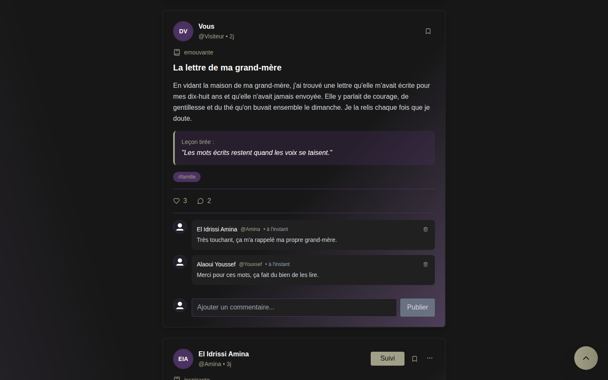
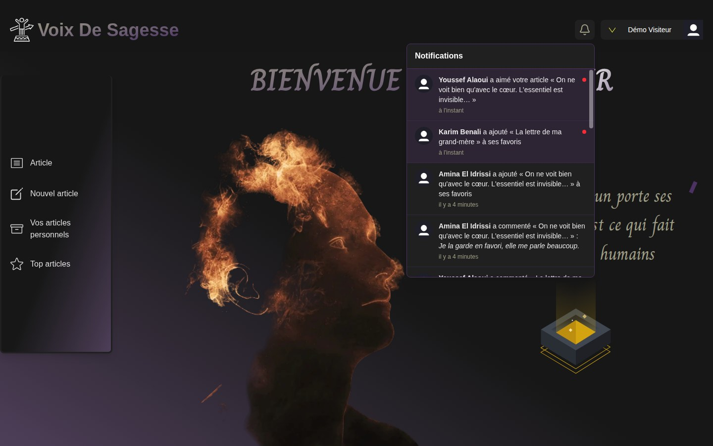
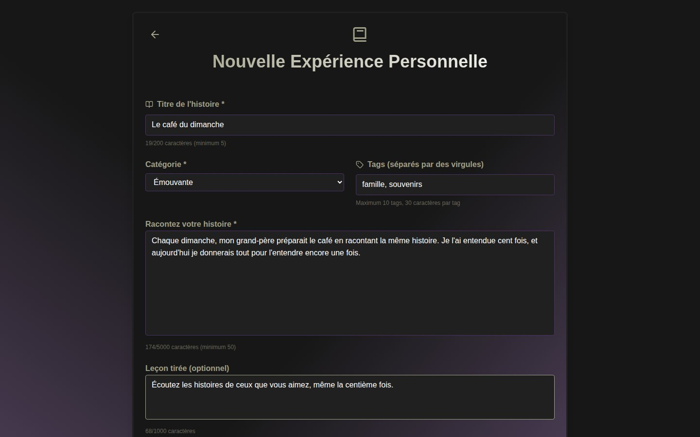
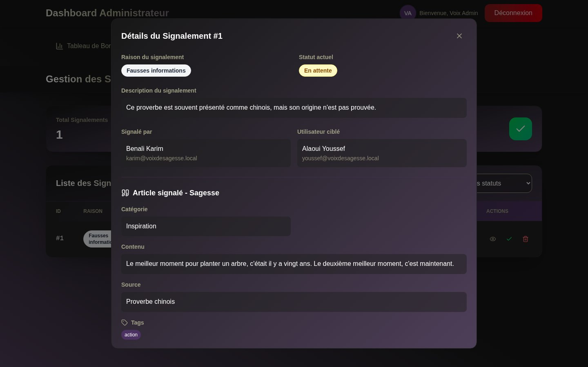
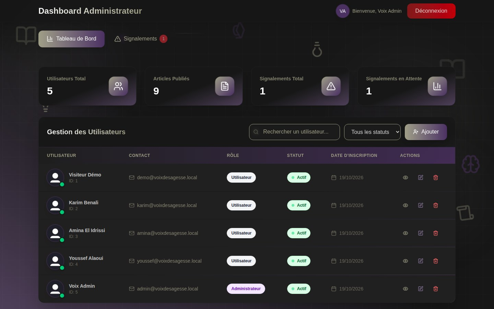
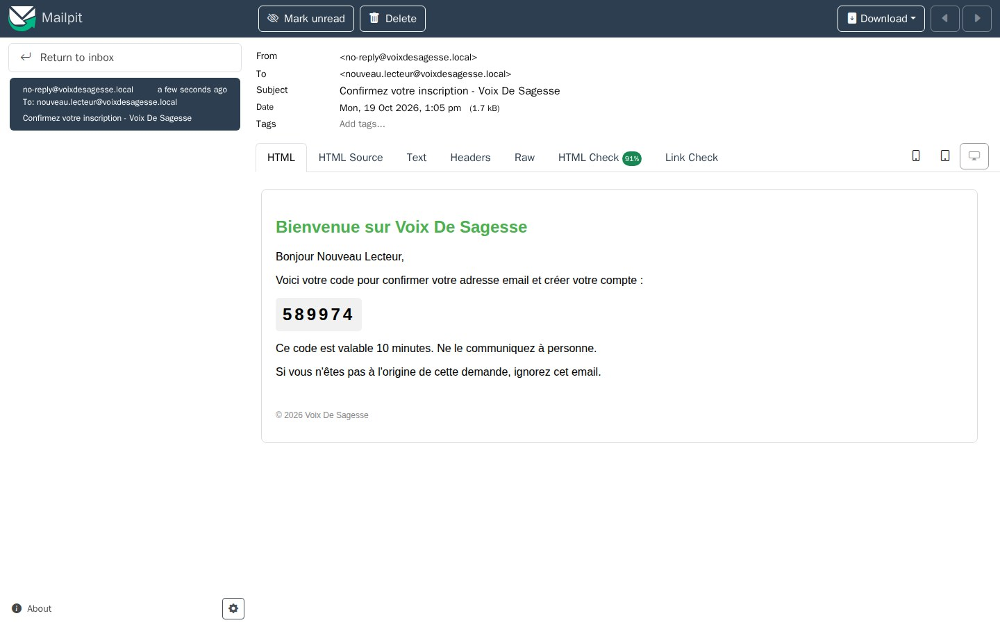
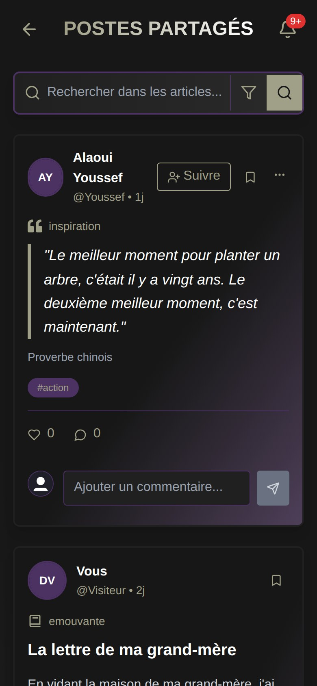
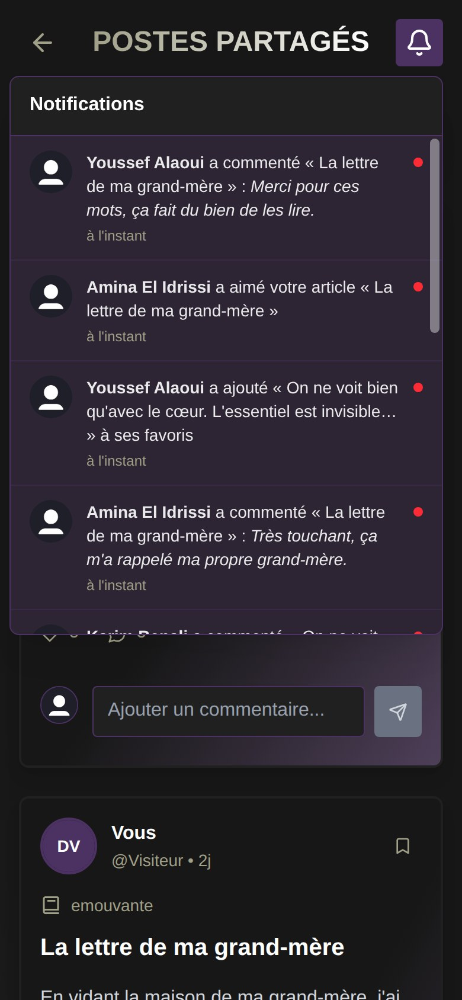
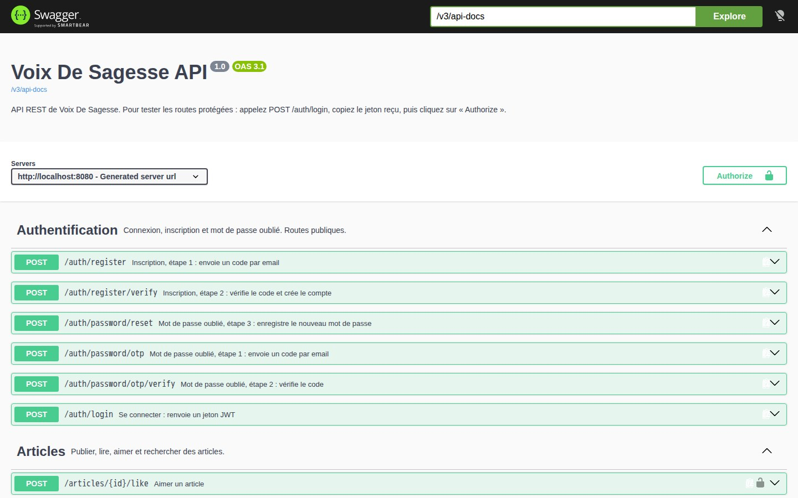
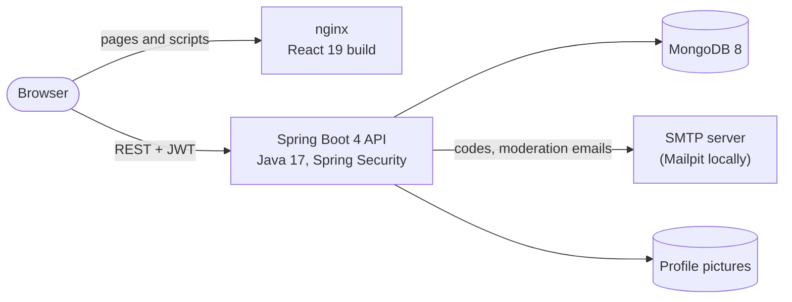

# Voix De Sagesse

A French-language social platform where people share wisdom (proverbs, quotes) and personal stories, then like, comment, save and follow each other. Reported content goes through an admin moderation workflow.

Built with **Spring Boot 4** (Java 17), **React 19** and **MongoDB**, tested at three levels, and runnable in one command with Docker Compose.

    

> **Live demo:** coming soon.


## Features

**For readers and authors**

- Sign-up confirmed with a 6-digit code sent by email, and password reset with the same kind of code
- Two kinds of articles: *wisdoms* (a quote or proverb with its source) and *stories* (a title, the story and the lesson learned), with categories and tags
- A feed of all articles, newest first, with search by text and by type
- Likes, comments, favorites, following other authors, public author profiles
- Notifications for likes, comments, favorites, new followers and moderation decisions, with an unread counter
- Profile with photo, bio, location and website, and account deletion
- Responsive layout, from phones to large screens

**For administrators**

- A dashboard with users, articles and reports
- Report review: read the reported article, then keep it or delete it. Deleting it settles every report on that article and tells its author, by email and in the app.

## Screenshots

| Feed and comments | Notifications |
|---|---|
|  |  |
| **Writing a story** | **Reviewing a report (admin)** |
|  |  |
| **Admin dashboard** | **Sign-up code, caught locally by Mailpit** |
|  |  |

<p align="center">
  
  &nbsp;&nbsp;
  
</p>

The API is documented with Swagger UI:



## Architecture



| Part | Technologies |
|---|---|
| **Backend** | Java 17, Spring Boot 4.1 (Web MVC, Security, Data MongoDB, Validation, Mail, Actuator), JJWT, springdoc-openapi, Lombok |
| **Frontend** | React 19, Vite 6, React Router 7, Redux Toolkit, Mantine 8, Tailwind CSS 4, Framer Motion, Axios |
| **Database** | MongoDB 8 |
| **Tests** | JUnit 5, Mockito, MockMvc · Vitest, Testing Library · Playwright |
| **Tooling** | Docker Compose, nginx, Mailpit, GitHub Actions, ESLint |

## Technical highlights

- **Security.** Stateless JWT authentication and BCrypt-hashed passwords. The acting user always comes from the token, never from an id sent by the client. Sign-up is confirmed by an emailed code; a password reset needs a short-lived code (10 minutes, 5 attempts) and then a single-use token. Failed logins are limited to 5 per 15 minutes, CORS only accepts the configured frontend, and admin routes require the admin role.
- **One error format.** Every error comes back as `{ errorMessage, errorCode, timeStamp }` with the right HTTP status (400, 403, 404, 409…) and a French message that the frontend shows once, as is.
- **Consistent data.** Likes use atomic MongoDB updates, so a double click cannot count twice. Notifications are not duplicated, disappear when the action is undone, and expire after 90 days through a TTL index.
- **Moderation workflow.** Deleting a reported article settles all its reports; reports are closed if the author deletes the article first. A failed email never undoes a decision.
- **Demo data.** On an empty database, the backend creates demo accounts and content through its own services, so counters and notifications match real use.
- **Tests at three levels.** 70 backend tests (unit, and integration against a real MongoDB), 37 frontend unit tests, and 26 end-to-end tests that drive a real browser through the whole app. Backend and frontend checks run on every pull request with GitHub Actions.

## Getting started

You only need Docker (with Docker Compose).

```bash
cp .env.example .env
echo "JWT_SECRET=$(openssl rand -base64 48)" >> .env
docker compose up --build
```

| Service | URL |
|---|---|
| App | http://localhost:5173 |
| API documentation (Swagger UI) | http://localhost:8080/swagger-ui.html |
| Emails sent by the app (sign-up and password codes) | http://localhost:8025 |

The first start creates demo accounts and articles:

| Account | Password | Role |
|---|---|---|
| `demo@voixdesagesse.local` | `Demo1234!` | user with articles, reactions and notifications |
| `karim@`, `amina@`, `youssef@voixdesagesse.local` | `Demo1234!` | other authors |
| `admin@voixdesagesse.local` | `Admin1234!` | administrator |

The passwords can be changed in `.env`. To work on one part without Docker, see the [backend](backend/README.md) and [frontend](frontend/README.md) READMEs.

## Tests

| Level | Tools | Command |
|---|---|---|
| Backend: unit and integration (70) | JUnit 5, Mockito, MockMvc | `cd backend && ./mvnw test`, with MongoDB running (`docker compose up -d mongo`) |
| Frontend: unit (37) | Vitest, Testing Library | `cd frontend && npm test` |
| End-to-end (26) | Playwright | `cd frontend && npm run test:e2e`, with the app running (`docker compose up`) |

Without Node, `frontend/e2e/run-in-docker.sh` runs the end-to-end tests in Playwright's Docker image.

## Project structure

```
.
├── backend/                 Spring Boot REST API
│   └── src/main/java/com/voixdesagesse/
│       ├── controller/      REST endpoints
│       ├── service/         business logic
│       ├── repository/      MongoDB access
│       ├── entity/, dto/    stored documents and API payloads
│       ├── security/        JWT filter, login attempt limiter
│       ├── config/          security, CORS, API documentation
│       ├── exception/       error handling
│       ├── mail/            email templates and sending
│       └── demo/            demo data loader
├── frontend/                React application
│   ├── src/
│   │   ├── pages/           landing, sign-up and login, user area, admin
│   │   ├── components/      shared components (post card, notification bell…)
│   │   ├── api/             calls to the API
│   │   ├── hooks/, store/   shared logic and Redux state
│   │   └── routes/          routing and access guards
│   └── e2e/                 end-to-end tests
├── docker-compose.yml       the whole app on your machine
└── .github/                 CI workflow and screenshots
```

## What I learned

- **Securing an API is about the details.** Reviewing my own code, I found an id trusted from the request, a password reset without a real check, and a role that could be chosen at sign-up. Since then I take the identity from the token and write tests that try to act as someone else.
- **Upgrading a framework safely.** Moving from Spring Boot 3.4 to 4.1 meant renamed properties, moved packages and the switch to Jackson 3. The test suite showed exactly what broke.
- **Each level of tests catches different bugs.** Unit tests check the logic; end-to-end tests caught problems that only appear when everything runs together, such as an error message shown twice.
- **A feature is more than its happy path.** Consistent error messages, loading and empty states, small screens, and data that stays consistent when an action is undone or an article is deleted.
- **Making a project easy to run.** With Docker Compose and demo data, anyone can try the whole app with one command.

## Possible improvements

- Real-time notifications (WebSocket or Server-Sent Events) instead of polling every 30 seconds
- Pagination or infinite scroll in the feed
- Profile pictures in an object storage service
- Readable category labels in the feed ("Émouvante" instead of "emouvante")
- End-to-end tests in the CI pipeline

## License

[MIT](LICENSE)

## Author

Oumaima Laghjibi · [GitHub](https://github.com/Oumaima-Lg)
